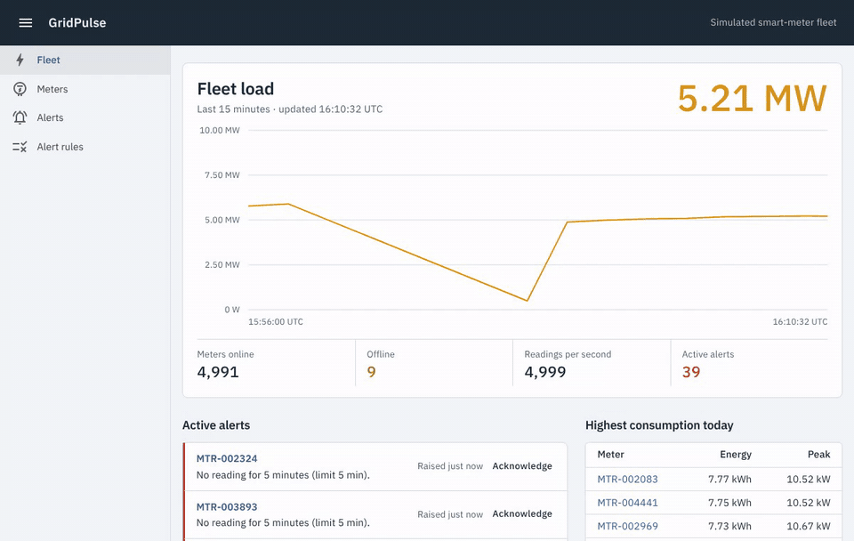
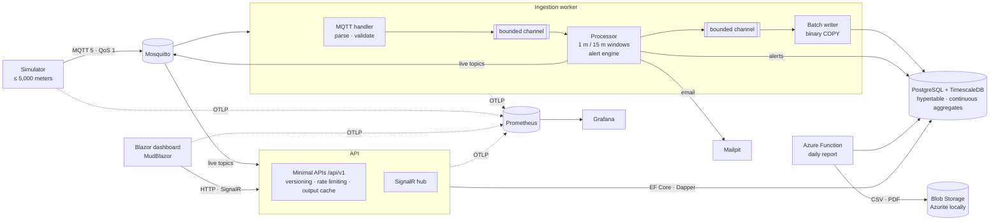
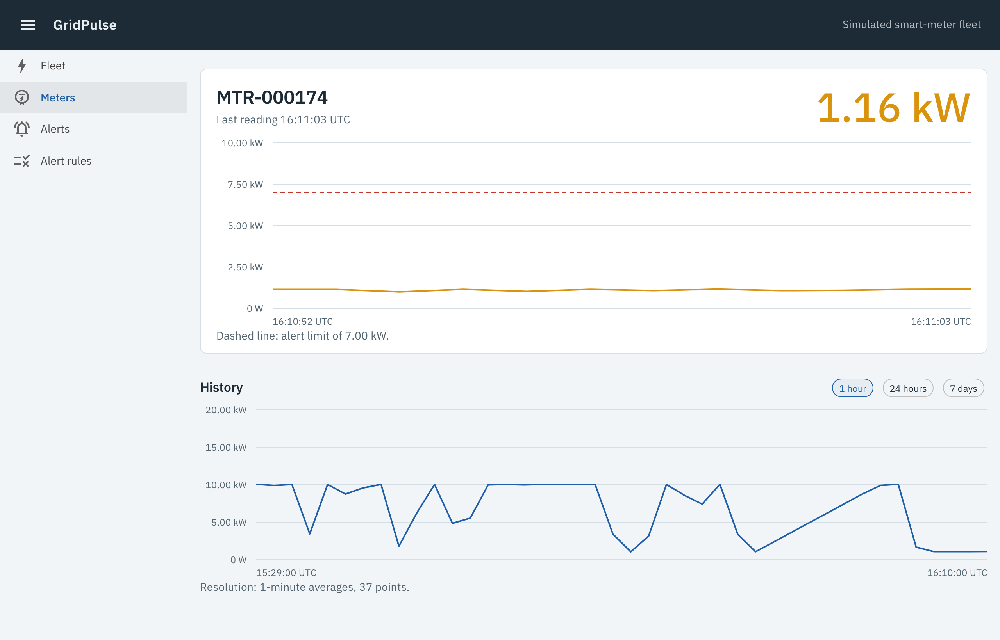
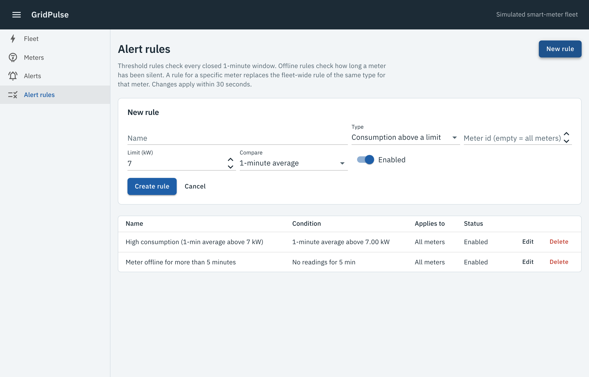
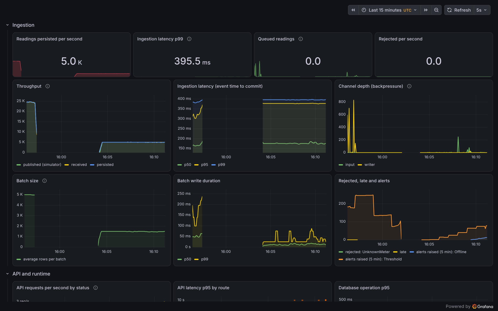
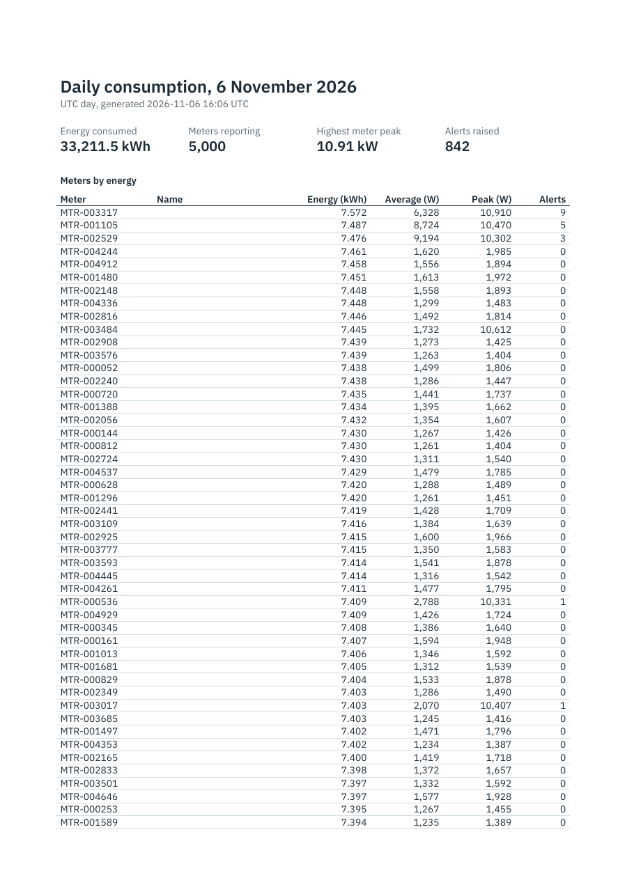

# GridPulse

Real-time monitoring of smart-meter energy consumption, built with .NET 10.

Simulated meters publish readings over MQTT. An ingestion service validates them, aggregates them
into 1- and 15-minute windows, raises alerts, and writes them to TimescaleDB in batches. A Blazor
dashboard shows the fleet live through SignalR, and an Azure Function produces a daily CSV/PDF
report. Everything starts with one `docker compose up`, and the same system deploys to Azure
Container Apps with Bicep.



## Measured, not claimed

All numbers come from one 4-vCPU cloud VM running the **whole stack**: broker, database, five
.NET services, Prometheus and Grafana. Method, raw tables and every optimisation round are in
[docs/benchmarks.md](docs/benchmarks.md).

| Scenario | Persisted readings/s | p50 | p99 | Ingestion CPU |
|---|---:|---:|---:|---:|
| 5,000 meters × 1 Hz (the requirement) | **4,986** | 180 ms | 396 ms | 0.22 cores |
| 5,000 meters × 5 Hz (sustained maximum) | **24,565** | 165 ms | 383 ms | 1.03 cores |

Latency is measured from the reading's own timestamp to the database commit.

| Optimisation | Before | After |
|---|---:|---:|
| Write a 5,000-row batch (EF Core → binary COPY with idempotent fallback) | 556 ms | **26 ms** |
| Simulator → broker throughput (Mosquitto `set_tcp_nodelay`) | 12,394 msg/s | **28,054 msg/s** |
| Pipeline processor, per reading (steady state, zero allocations) | — | **29 ns** |

## Architecture



How it works:

- **Ingestion is a three-stage `System.Threading.Channels` pipeline with real backpressure.**
  - The channels are bounded and wait when full. The MQTT client acknowledges a message only once
    it is queued, and it advertises MQTT 5 *Receive Maximum*.
  - When the database slows down, messages wait in the broker, not in ingestion's memory.
- **One processor thread owns all per-meter state**, so it needs no locks: about 29 ns and zero
  allocations per reading.
- **Aggregation happens twice, deliberately.**
  - In the stream (event time, allowed lateness) for live charts and alerts.
  - In TimescaleDB continuous aggregates for history and reports.
  - An integration test proves both produce the same numbers.
- **Writes are idempotent.** QoS 1 can redeliver, and the primary key `(meter_id, time)` absorbs it.
  The writer uses a raw `COPY` and falls back to an `ON CONFLICT` merge only when a duplicate
  actually appears.

## Run it

You need Docker. Every host port is in **5300–5399**.

```bash
docker compose up --build
```

The first build takes a few minutes. Then open:

| Port | What |
|---|---|
| [5300](http://localhost:5300) | Dashboard (Blazor) |
| [5301](http://localhost:5301/scalar) | API reference (Scalar, OpenAPI v1) |
| [5331](http://localhost:5331) | Grafana, with the GridPulse dashboard as the home page |
| [5340](http://localhost:5340) | Mailpit (alert emails) |
| [5330](http://localhost:5330) | Prometheus |
| 5310 · 5320 · 5350 · 5360 | PostgreSQL · MQTT · Azurite blob · Reports Function |

Common tasks:

- **Scale the fleet:**

  ```bash
  GRIDPULSE_METERS=5000 docker compose up -d
  ```

- **Generate a daily report now** (development key, see `deploy/functions`):

  ```bash
  curl -X POST "http://localhost:5360/api/reports/daily?date=$(date -u +%F)" -H "x-functions-key: local-dev-key"
  ```

- **Run a load test.** The rate is meters ÷ interval, here 25,000 readings/s:

  ```bash
  CONNECTIONS=4 tools/loadtest/run.sh 5000 00:00:00.2
  ```

- **See an alert fire quickly:** create a rule on *Alert rules* with a low limit for one meter. The
  simulator also injects random consumption spikes and meters that go silent.

## Tour

| Path | What is in it |
|---|---|
| `src/GridPulse.Core` | Pure domain: validation, window aggregation, alert engine, message contracts. No I/O. |
| `src/GridPulse.Ingestion` | The Channels pipeline, MQTT consumer, alert dispatcher, email |
| `src/GridPulse.Api` | Minimal API endpoint groups, versioning, rate limiting, output caching, SignalR hub |
| `src/GridPulse.Web` | Blazor Web App (Interactive Server) with MudBlazor and a small SVG chart |
| `src/GridPulse.Reports` | Azure Function (isolated worker): timer and HTTP triggers, CSV and PDF |
| `src/GridPulse.Simulator` | Deterministic residential load model with spikes and outages |
| `src/GridPulse.Infrastructure` | EF Core model and migrations, edition-aware TimescaleDB setup, COPY writer, Dapper queries |
| `src/GridPulse.Migrator` | One-shot migrations (a compose service locally, a Container Apps Job in Azure) |
| `tests/` | Unit (xUnit, Shouldly, FakeTimeProvider), integration (Testcontainers), component (bUnit) |
| `benchmarks/` | BenchmarkDotNet: parsing, processor, pipeline, database writers |
| `deploy/` | Bicep, Kubernetes manifests, Mosquitto, Prometheus and Grafana configuration |
| `docs/` | [Plan](docs/PLAN.md), [ADRs](docs/adr/README.md), [benchmarks](docs/benchmarks.md), [Azure deployment](docs/deploy-azure.md) |

## Decisions worth asking about

Each has an ADR with the options considered and the costs accepted.

- [**TimescaleDB, edition-aware.**](docs/adr/0001-timescaledb.md) Azure Database for PostgreSQL ships
  only TimescaleDB's Apache-2 edition, so there are no continuous aggregates there. The migrator
  detects the edition, and the integration tests run against both editions.
- [**Channels instead of Kafka or Event Hubs.**](docs/adr/0002-in-process-channels-pipeline.md) What
  is lost on a crash, why ingestion runs as one replica, and how it would scale out.
- [**EF Core, Dapper and COPY side by side.**](docs/adr/0004-write-paths.md) Each data-access
  workload uses the tool its benchmark supports.
- [**SignalR without a backplane.**](docs/adr/0006-live-fan-out.md) Every API replica subscribes to
  the live topics itself.
- [**Aggregating twice.**](docs/adr/0009-stream-and-database-aggregation.md) The stream path is for
  latency, the database path is for truth, and a test keeps them in agreement.
- [**Container Apps instead of AKS.**](docs/adr/0005-container-apps.md)
- [**No QuestPDF, and PDFsharp pinned to 6.2.4.**](docs/adr/0008-daily-report-function.md) PDFsharp
  6.5 changed its licence to AGPL. That was found while building, not after shipping.

## Quality

```bash
dotnet test --project tests/GridPulse.UnitTests
dotnet test --project tests/GridPulse.Web.Tests
dotnet test --project tests/GridPulse.IntegrationTests   # needs Docker
```

| Suite | What it covers |
|---|---|
| Unit (65) | Window boundaries and lateness, validation, the alert state machine with `FakeTimeProvider`, pipeline backpressure and graceful drain, simulator determinism, CSV/PDF |
| Integration (33) | Real TimescaleDB in **both** editions and Mosquitto via Testcontainers: migrations, idempotent COPY, stream-vs-database consistency, alert store, daily report query, the API (versioning, 429s, output cache eviction), and SignalR end to end |
| Component (16) | bUnit: chart, fleet status, alert list, connection banner, fleet page with a fake live feed (including a live update during the history load), rule form validation |

- **CI (GitHub Actions):** every push builds with warnings as errors and runs all three suites. It
  also builds and lints the Bicep, validates the Kubernetes manifests, and checks that compose only
  uses host ports 5300–5399.
- **Deployment:** a manual, OIDC-authenticated workflow is ready ([docs/deploy-azure.md](docs/deploy-azure.md)).

Libraries are chosen with their licences in mind: no MediatR, AutoMapper, MassTransit,
FluentAssertions or QuestPDF.

## Screenshots

| Meter detail: live and historical power, with the alert limit | Alert rules |
|---|---|
|  |  |

| Grafana: throughput, latency, backpressure, runtime | Daily report (PDF) |
|---|---|
|  |  |

## Not in scope (and what production would add)

- **Authentication.** Entra ID on the dashboard and API; authenticated MQTT with client
  certificates or Event Grid's MQTT broker.
- **Private networking.** A VNet with private endpoints; Entra ID authentication to PostgreSQL
  instead of a password.
- **Beyond one broker.** A clustered MQTT broker, plus key-affine partitioning across several
  ingestion replicas (ADR-0002).
- **Custom metrics in Azure.** Export them to Azure Monitor (locally they go to Prometheus).
