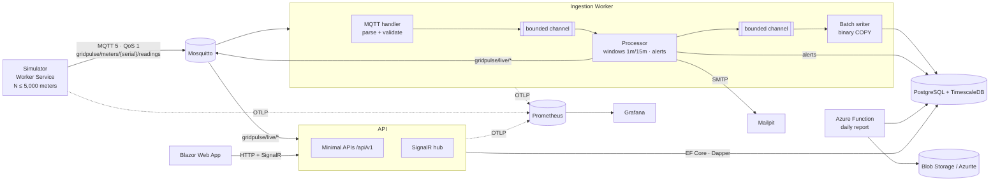

# GridPulse — Implementation Plan

> Status: **approved** (revision 2). Revision 1 was approved with one instruction: *"no
> over-engineering, keep it clean"*. This revision removes everything that did not earn its
> place. The removed items are listed in §9, so the trade-offs remain visible.

GridPulse is a real-time energy monitoring platform for (simulated) smart meters, built as a
portfolio project. Every non-obvious decision is explicit, measured and defensible.

---

## 1. Goals, constraints and success criteria

### Goals

- Ingest meter readings over MQTT.
- Validate the readings, aggregate them in 1-minute and 15-minute windows, and batch-insert them
  into PostgreSQL + TimescaleDB.
- Live dashboard (Blazor + MudBlazor) fed by SignalR. Historical charts come from a versioned,
  rate-limited, output-cached Minimal API.
- Configurable alerts (threshold exceeded; meter offline for more than 5 min), sent via SignalR
  and email.
- Daily CSV/PDF report produced by an Azure Function and stored in Blob Storage.
- Deployable to Azure Container Apps + PostgreSQL Flexible Server + Storage with Bicep. Plain
  Kubernetes manifests are provided as an alternative.
- OpenTelemetry metrics in Prometheus, with a provisioned Grafana dashboard.

### Hard constraints

| Constraint | How it is enforced |
|---|---|
| .NET 10 (LTS) | `global.json`; every project targets `net10.0` |
| `docker compose up` starts everything | Root `compose.yaml`; migrations run as a one-shot service |
| Host ports only in **5300–5399** | Port map (§6) |
| No MediatR, AutoMapper, MassTransit or FluentAssertions | Hand-written mapping and handlers; Shouldly for assertions |
| Green build and tests at the end of every phase | `dotnet build` (warnings as errors) + `dotnet test` before every push |
| Deploy workflow ready but **not executed** | `workflow_dispatch` only, OIDC authentication, documented |

### Success criteria

1. `docker compose up` on a clean machine shows live data on the dashboard within about 30 s.
2. The README publishes:
   - sustained throughput (readings/s);
   - ingestion latency p50/p95/p99.

   Both figures are reproducible with a script, and the README states the hardware they were
   measured on.
3. BenchmarkDotNet before/after tables for each ingestion optimisation.
4. ADRs for the decisions a tech lead would challenge.

### Non-goals

- Authentication/authorisation.
- Exactly-once delivery: the system is at-least-once with idempotent writes.
- Real meter protocols.
- Billing.
- A highly available MQTT broker.
- A .NET Aspire AppHost (the brief requires Compose).

---

## 2. Decisions

| # | Decision | Why (details in the ADR) |
|---|---|---|
| D1 | **TimescaleDB edition-aware migration.** Full edition (local Docker): hierarchical **continuous aggregates** `readings_1m → readings_15m → readings_1h`, plus compression and retention policies. Apache-2 edition (**Azure Flexible Server only ships this one**): the same names exist as plain `time_bucket` **views**. | Query code stays identical in both cases. On Azure, aggregates are computed at query time, which is slower but correct. The integration tests cover both modes. ADR-0001. |
| D2 | **EF Core** for CRUD and migrations; **Dapper** for analytics; **binary `COPY`** for the readings hot path. EF Core is the benchmark baseline. | Measured before/after numbers. ADR-0004. |
| D3 | Blazor **Interactive Server** | Operator dashboard with few users. The SignalR client stays server-side, so there is no CORS and no tokens in the browser. ADR-0007. |
| D4 | **Plain Kubernetes manifests** (no Helm) | The simplest alternative to Bicep; no templating to maintain. |
| D5 | Observability phase before IaC | The performance numbers need Prometheus. |
| D6 | **Single ingestion replica**, scaled vertically | Window state lives in memory, and MQTT shared subscriptions do not route by key. ADR-0002 describes the scale-out path. |

---

## 3. Architecture



### Solution layout

```
GridPulse.slnx · global.json · Directory.Build.props · Directory.Packages.props · compose.yaml
src/
  GridPulse.Core/             Pure: readings, validation, window aggregation, alert rules, message contracts. No I/O.
  GridPulse.Infrastructure/   EF Core DbContext + migrations, Dapper queries, COPY writer, MQTT options
  GridPulse.ServiceDefaults/  OpenTelemetry + health checks (shared by all hosts)
  GridPulse.Migrator/         One-shot: applies migrations, seeds default alert rules
  GridPulse.Simulator/        Worker Service
  GridPulse.Ingestion/        Worker Service
  GridPulse.Api/              Minimal APIs + SignalR hub
  GridPulse.Web/              Blazor Web App + MudBlazor
  GridPulse.Reports/          Azure Functions (isolated worker)
tests/
  GridPulse.UnitTests/        xUnit + Shouldly + FakeTimeProvider
  GridPulse.IntegrationTests/ Testcontainers (TimescaleDB, Mosquitto) + WebApplicationFactory
  GridPulse.Web.Tests/        bUnit
benchmarks/GridPulse.Benchmarks/
deploy/  mosquitto/ prometheus/ grafana/ bicep/ k8s/
docs/    PLAN.md  adr/  benchmarks.md  deploy-azure.md  images/
```

Reference rules:

- `Core` references nothing.
- `Web` references only `Core` (for the contracts) and talks to the API over HTTP and SignalR.

---

## 4. Component design

### 4.1 Simulator

- **Configuration:** `MeterCount` (1–5,000), `PublishInterval` (default 1 s), `Seed`,
  `SpikeProbability`, `OfflineProbability`.
- **Load model:**
  - a base load plus a daily curve (morning and evening peaks), noise, and occasional spikes;
  - the energy register is monotonic;
  - deterministic for a given seed.
- **Fault injection:** some meters spike above the threshold; some go silent for 6–10 min.
- **Scheduling:**
  - One `PeriodicTimer` on `TimeProvider`, not 5,000 timers.
  - Each tick publishes one slice of the meters, so load is spread across the interval.
  - All publishing goes through one MQTT connection.
- **Provisioning:** registers its meters at startup through `POST /api/v1/meters/batch`
  (idempotent).
- **Payload:** JSON, QoS 1:

  ```json
  {"meterId":"MTR-000123","ts":"…","powerW":1234.5,"energyWh":5532100,"voltageV":231.2}
  ```

### 4.2 Ingestion — a three-stage Channels pipeline

```
MQTT handler (parse with source-generated JSON + stateless validation)
   └─▶ bounded channel (FullMode=Wait → backpressure into MQTTnet → TCP → Mosquitto)
        └─▶ Processor (single reader, owns all state, no locks)
              ├─ stateful validation: unknown meter, duplicate/out-of-order timestamp, register regression
              ├─ WindowAggregator 1m + 15m (event time, UTC-aligned like time_bucket, allowed lateness)
              ├─ AlertEngine (threshold on closed 1m windows, offline via last-seen)
              ├─ live publisher (fleet snapshot + latest per meter, once per second)
              └─▶ bounded channel ──▶ BatchWriter: flush at 5,000 rows OR 250 ms, binary COPY
```

- **One processor thread.** Updating a dictionary of struct states costs well under a
  microsecond per reading, so one thread covers the target with headroom. If profiling ever
  shows the processor is saturated, partitioning by meter becomes the next step.
- **Time.**
  - `TimeProvider` is injected everywhere.
  - Window close and the offline check are driven by a periodic tick written to the **same**
    channel as the readings, so all state is touched by one thread.
- **Late readings** (beyond `windowEnd + allowedLateness`):
  - still persisted, because the database is the source of truth;
  - counted as late;
  - excluded from the live view.
- **Delivery:**
  - MQTT acknowledges a message once it has been enqueued. A crash can lose whatever is in the
    in-memory buffers; the loss window is bounded by channel capacity (ADR-0002).
  - Graceful shutdown drains every buffer.
  - The `(meter_id, time)` primary key plus `ON CONFLICT DO NOTHING` absorbs QoS 1 redeliveries.
- **Database outages:** transient Npgsql errors are retried with exponential backoff. Meanwhile
  the channels fill, backpressure propagates, and `/health/ready` turns red.

### 4.3 Database

| Relation | Kind |
|---|---|
| `meters` | table (EF Core) |
| `readings(time, meter_id, power_w, energy_wh, voltage_v)` | **hypertable**, PK `(meter_id, time)` |
| `readings_1m` → `readings_15m` → `readings_1h` | hierarchical continuous aggregates (full edition) / views (Apache edition) |
| `alert_rules`, `alerts` | tables (EF Core) |

- **Migrations:** EF Core. The TimescaleDB DDL uses `migrationBuilder.Sql(..., suppressTransaction: true)`,
  because continuous aggregates cannot be created inside a transaction.
- **Retention:** 7 days of raw readings locally (full edition). Rollups are kept longer.

### 4.4 API

- **Endpoint groups:** one static class per feature, with handlers that return `TypedResults`.
- **Versioning:** `Asp.Versioning.Http`, `/api/v1/...`.
- **Validation:** built-in .NET 10 Minimal API validation; RFC 9457 Problem Details.
- **Rate limiting:** built-in, per client IP; token bucket for writes, fixed window for reads.
- **Output caching:** historical ranges are cached. Queries that touch the last minute are not.
  Cache entries are tagged per meter and evicted on update.
- **Readings endpoint:** `GET /meters/{id}/readings?from&to&resolution=auto|raw|1m|15m|1h`.
  `auto` keeps the result at ≤ 1,000 points.
- **Analytics (Dapper):** fleet summary and top-N consumers.
- **SignalR hub** `/hubs/telemetry` (strongly typed):
  - A hosted service subscribes to `gridpulse/live/#` and broadcasts.
  - Every replica receives every live message, so **no backplane** is needed (ADR-0006).
- **OpenAPI:** built-in document, with Scalar UI.
- **Health checks:** `/health/live` and `/health/ready`.

### 4.5 Web

- **Pages:**
  - Dashboard: KPIs, live fleet chart, active alerts.
  - Meters: grid.
  - Meter detail: live and historical charts.
  - Alerts: list with acknowledge.
  - Alert rules: CRUD.
- **Testability:** live data comes through an `ITelemetryFeed` interface, so bUnit tests use a fake.
- **Memory:** charts keep a fixed-size buffer.

### 4.6 Alerts

- **Rule types:**
  - **Threshold:** average or maximum power of a closed 1-minute window exceeds a limit. The rule
    applies to the whole fleet or to a single meter.
  - **Offline:** no reading for more than N minutes (default 5).
- **Rule storage:** rules live in the database and are reloaded by ingestion every 30 s.
- **State machine:** `Firing → Resolved`, with at most one open alert per `(rule, meter)`.
- **Dispatch:** each alert is persisted (EF Core), published to the live topic (which reaches
  SignalR), and emailed via MailKit to Mailpit. Email has a per-alert cooldown.
- **Tests:** `FakeTimeProvider` drives the timing cases: 4:59 → no alert, 5:01 → alert, the next
  reading → resolved.

### 4.7 Reports Function

- **Triggers:**
  - a timer at 00:15 UTC that reports on the previous day;
  - an HTTP trigger for manual runs.
- **Data:** Dapper over `readings_1h` plus the day's alerts.
- **Outputs:**
  - **CSV:** hand-written (no dependency needed), invariant culture.
  - **PDF:** PDFsharp-MigraDoc (MIT). QuestPDF was rejected because its licence is commercial
    above a revenue threshold.
- **Storage:** `reports/daily/yyyy/MM/dd/…` in Blob Storage (Azurite locally). Reruns overwrite
  the same files, so the job is idempotent.

### 4.8 Observability

- **Export:** OpenTelemetry → OTLP → **Prometheus 3's native OTLP receiver** (no collector
  container), with Grafana provisioned.
- **Custom metrics:**
  - readings received / persisted / rejected (by reason) / late;
  - ingestion latency histogram (event time → commit);
  - queue depth per channel;
  - batch size;
  - alerts raised.
- **Built-in metrics:** ASP.NET Core, runtime, Npgsql.

---

## 5. Infrastructure as code

### Bicep

Resources:

- Log Analytics + Application Insights.
- PostgreSQL Flexible Server (Burstable B1ms) with public access, TLS required, and an
  "Allow Azure services" firewall rule.
- Storage Account with a `reports` container.
- Azure Container Registry.
- A user-assigned managed identity for `AcrPull` and blob access.
- A Container Apps environment running:
  - `mosquitto` (internal TCP)
  - `ingestion` (1 replica)
  - `api` (external)
  - `web` (external)
  - `simulator`
  - `reports` (Functions on Container Apps)
  - `migrator` (Container Apps Job)

Secrets go in as `@secure()` parameters and are stored as Container Apps secrets.

A VNet with private endpoints is the production upgrade, and ADR-0005 explains why it is not used
here.

### Kubernetes

`deploy/k8s/` holds plain manifests (Deployments, Services, ConfigMap, Secret template, and a
Job for the migrator), validated in CI with `kubeconform`.

### GitHub Actions

| Workflow | Trigger | What it does |
|---|---|---|
| `ci.yml` | every push / PR | build + all tests (Testcontainers runs on the runner's Docker), `az bicep build`, `kubeconform` |
| `deploy-azure.yml` | `workflow_dispatch` only | OIDC `azure/login` → build and push images to ACR → `what-if` → deploy → run the migrator job → smoke test. Documented in `docs/deploy-azure.md`. **Not executed.** |

---

## 6. Port map (host ports 5300–5399 only)

| Port | Service |
|---|---|
| 5300 | Web |
| 5301 | API (Scalar UI at `/scalar`) |
| 5310 | PostgreSQL / TimescaleDB |
| 5320 | Mosquitto |
| 5330 | Prometheus |
| 5331 | Grafana |
| 5340 | Mailpit UI |
| 5350 | Azurite (blob) |
| 5360 | Reports Function |

Ingestion, Simulator and Migrator expose no host ports. Testcontainers uses random ports, but only
during tests.

---

## 7. Phases

Each phase ends green (build + tests) and is pushed. ADRs are written in the phase where the
decision is made.

| # | Phase | Deliverables |
|---|---|---|
| 0 | Foundation | Solution, central package management, build props, CI, compose skeleton |
| 1 | Simulator → MQTT | Load model, scheduler, publisher; unit tests; ADR-0003 (MQTT) |
| 2 | Ingestion (in-memory) | Parser, validation, aggregator, processor, channels, drain; unit tests; parsing/aggregation benchmarks; ADR-0002 (Channels vs external queue) |
| 3 | Persistence | EF Core model, migrations (D1), COPY writer, Migrator; Testcontainers tests (both editions, idempotency, stream-vs-DB consistency); writer benchmarks; ADR-0001 (TimescaleDB), ADR-0004 (write paths) |
| 4 | API + SignalR | Endpoints, versioning, rate limiting, caching, Dapper analytics, hub + live bridge; integration tests; ADR-0006 (live fan-out) |
| 5 | Web | Dashboard, meters, meter detail, live charts; bUnit; ADR-0007 (Blazor). **End-to-end slice from `docker compose up`.** |
| 6 | Alerts | Rules, engine, dispatcher, email, UI; FakeTimeProvider tests |
| 7 | Reports Function | Timer + HTTP triggers, CSV, PDF, Blob/Azurite; tests; ADR-0008 (reporting) |
| 8 | Observability | OTel wiring, Prometheus, Grafana dashboard |
| 9 | Performance | Load test script, optimisation rounds with before/after numbers, `docs/benchmarks.md` |
| 10 | IaC + deploy | Bicep, k8s manifests, deploy workflow (OIDC), `docs/deploy-azure.md`; ADR-0005 (Container Apps vs AKS) |
| 11 | Polish | README (Mermaid, screenshots, numbers), final review |

---

## 8. Testing

| Layer | Tools | Focus |
|---|---|---|
| Unit | xUnit, Shouldly, FakeTimeProvider | Windows, lateness, validation, alert timing, simulator model, CSV |
| Integration | Testcontainers (TimescaleDB in full **and** Apache mode; Mosquitto), WebApplicationFactory | Migrations, idempotent COPY, stream-vs-DB consistency, API behaviour, MQTT end to end |
| Component | bUnit | Dashboard, alert list, rule form |
| Performance | BenchmarkDotNet, load-test script | Before/after per optimisation |

Test doubles are hand-written fakes. No mocking library is used.

---

## 9. Removed from revision 1 (and why)

| Removed | Reason |
|---|---|
| Partitioned processor channels | One processor thread is enough for the target; partitioning comes back only if profiling demands it |
| Dynamic per-meter MQTT subscriptions in the API | Ingestion publishes one compact "latest per meter" message per second instead |
| `pg_cron` rollups on Azure | Plain `time_bucket` views give the same query surface with no scheduler |
| Helm chart | Plain manifests are enough for an alternative deployment target |
| VNet, private DNS, Key Vault | Not essential for a demo deployment; documented as the production upgrade |
| Architecture-test project, NSubstitute, separate Contracts/Domain projects | Fewer moving parts; `Core` holds both |
| Trace propagation through MQTT | Out of scope; metrics are what the performance story needs |
